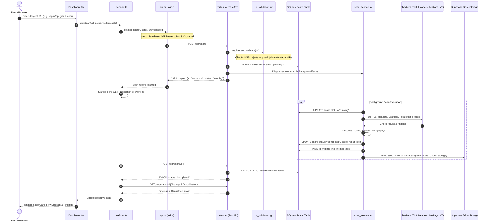

# AEGIS Project Structure & Developer Guide

This document is the architectural reference for navigating, extending, and maintaining the AEGIS codebase.

---

## 1. Directory Tree

```
AEGIS/
├── .env.example                     # Reference for all required environment variables
├── .gitignore                       # Clean Git exclusion rules
├── docker-compose.yml               # Multi-container orchestration (FastAPI + React/Nginx)
├── package.json                     # Monorepo task runner (npm run dev/build/test/lint)
├── README.md                        # Project overview, quickstart & features
│
├── docs/
│   └── PROJECT_STRUCTURE.md         # This developer and architectural guide
│
├── backend/
│   ├── Dockerfile                   # Python 3.12-slim production container
│   ├── pytest.ini                   # Pytest configuration (tests/, asyncio mode)
│   ├── requirements.txt             # Locked Python dependencies
│   ├── .env.example                 # Backend environment variable template
│   │
│   ├── app/                         # Application source package
│   │   ├── __init__.py
│   │   ├── main.py                  # FastAPI entry point, CORS, lifespan & router mounting
│   │   ├── config.py                # Pydantic Settings loaded from .env
│   │   ├── database.py              # Async SQLAlchemy engine, session provider & table init
│   │   ├── schemas.py               # Pydantic validation models (Requests, Responses, Telemetry)
│   │   │
│   │   ├── api/                     # HTTP Presentation Layer
│   │   │   ├── __init__.py
│   │   │   ├── auth.py              # UserContext dependency & Supabase JWT extraction
│   │   │   └── routes.py            # API routes (/health, /scans, /specifications, etc.)
│   │   │
│   │   ├── models/                  # Database Entities (SQLAlchemy ORM)
│   │   │   ├── __init__.py
│   │   │   ├── scan.py              # Scan model (status, scores, metadata, workspace_id)
│   │   │   └── finding.py           # Finding model (vulnerabilities & recommendations)
│   │   │
│   │   ├── scanners/                # Security Check Engines
│   │   │   ├── __init__.py
│   │   │   ├── tls_checker.py       # Test 1: HTTPS & TLS validation (30 pts)
│   │   │   ├── headers_checker.py   # Test 2: Context-aware security headers (20 pts)
│   │   │   ├── leakage_checker.py   # Test 3: Secret & information leakage detection (25 pts)
│   │   │   └── reputation_checker.py# Test 4: VirusTotal / Google Safe Browsing reputation (25 pts)
│   │   │
│   │   ├── security/                # Security & Defense Infrastructure
│   │   │   ├── __init__.py
│   │   │   ├── redaction.py         # Secret masking (Bearer tokens, passwords, keys)
│   │   │   └── url_validation.py    # SSRF protection (private IP blocking & DNS resolution)
│   │   │
│   │   └── services/                # Core Business Logic Layer
│   │       ├── __init__.py
│   │       ├── scan_service.py      # Primary scan pipeline orchestrator
│   │       ├── operation_scan_service.py # OpenAPI operation scanner with parameter injection
│   │       ├── scoring.py           # Evidence-based 0–100 security scoring engine
│   │       ├── visualization_service.py  # Latency samples, React Flow graph builder
│   │       ├── report_service.py    # Downloadable PDF report generation via ReportLab
│   │       ├── history_service.py   # Scan history queries, workspace scoping & comparison
│   │       ├── openapi_service.py   # OpenAPI 3.0 spec parsing & validation
│   │       └── supabase_sync.py     # Background synchronization to Supabase DB & Storage
│   │
│   └── tests/                       # Automated Backend Test Suite
│       ├── test_headers.py          # Security header test cases
│       ├── test_leakage.py          # Secret & pattern leakage test cases
│       ├── test_live_endpoints.py   # Live endpoint & report integration tests
│       ├── test_operation_scan.py   # Spec-based operation scan tests
│       ├── test_scoring.py          # Scoring engine calculation tests
│       └── test_url_validation.py   # SSRF defense & IP blocking tests
│
└── frontend/
    ├── Dockerfile                   # Multi-stage production container
    ├── nginx.conf                   # Production SPA routing configuration
    ├── index.html                   # HTML entry point with viewport & favicon
    ├── package.json                 # Frontend dependencies and npm scripts
    ├── tsconfig.json                # TypeScript project references
    ├── tsconfig.app.json            # Application TS compiler options
    ├── tsconfig.node.json           # Vite node configuration
    ├── vite.config.ts               # Vite configuration (port 3000, /api proxy to 8000)
    ├── .oxlintrc.json               # Fast Oxlint configuration
    ├── .env.example                 # Frontend environment variables template
    ├── README.md                    # Frontend-specific architecture documentation
    │
    ├── public/                      # Static Assets
    │   └── favicon.svg              # AEGIS shield logo
    │
    └── src/
        ├── main.tsx                 # React application mounting
        ├── App.tsx                  # BrowserRouter, route guards & layout assembly
        ├── index.css                # Dark cyber-intelligence design tokens & animations
        │
        ├── __tests__/               # Frontend Unit Tests
        │   └── tokens.test.ts       # Design system and probe configuration tests
        │
        ├── components/              # React UI Components
        │   ├── ui/                  # Reusable primitive UI components
        │   │   ├── index.ts         # Barrel export
        │   │   ├── Badge.tsx        # Status & severity badges
        │   │   ├── Button.tsx       # Standard cyber action buttons
        │   │   ├── Card.tsx         # Dark glassmorphism cards
        │   │   ├── Feedback.tsx     # Alerts and inline feedback banners
        │   │   ├── Input.tsx        # Stylized form inputs
        │   │   └── Modal.tsx        # Accessible dialog overlays
        │   ├── Layout.tsx           # App shell: sidebar, workspace switcher, nav
        │   ├── ProtectedRoute.tsx   # Auth guard for authenticated routes
        │   ├── ScoreCard.tsx        # Security assessment score dial
        │   ├── TestResultCard.tsx   # Expandable check result card
        │   ├── LatencyChart.tsx     # Recharts latency response line chart
        │   ├── FindingsChart.tsx    # Recharts findings severity distribution
        │   ├── FlowDiagram.tsx      # React Flow interactive probe lifecycle diagram
        │   └── RequestInspector.tsx # Sanitized HTTP payload and header viewer
        │
        ├── contexts/                # State Contexts
        │   ├── AuthContext.tsx      # Supabase Auth session & user state
        │   └── WorkspaceContext.tsx # Team, multi-tenant workspace & role state
        │
        ├── hooks/                   # Custom Hooks
        │   └── useScan.ts           # Asynchronous scan creation, polling & state
        │
        ├── lib/                     # Third-Party Singletons
        │   └── supabase.ts          # Supabase client initialization
        │
        ├── pages/                   # Routed Pages
        │   ├── LandingPage.tsx      # Public landing page with interactive terminal
        │   ├── AuthPage.tsx         # Sign in / sign up modal
        │   ├── AuthCallback.tsx     # OAuth callback handler
        │   ├── Dashboard.tsx        # Instant scan launcher & recent results
        │   ├── ScanResults.tsx      # Deep scan telemetry, charts & findings
        │   ├── ScanHistory.tsx      # Audit history & scan-to-scan comparison
        │   ├── TeamManagement.tsx   # Workspace invitations & team member roles
        │   ├── SpecAnalyzer.tsx     # OpenAPI 3.0 spec parser and endpoint explorer
        │   ├── OperationScan.tsx    # Granular single-operation probe wizard
        │   └── Settings.tsx         # System status, health & API keys
        │
        ├── services/                # Client Data Layer
        │   ├── api.ts               # Central Axios client with auth interceptors
        │   ├── supabaseService.ts   # Direct Supabase database and storage queries
        │   └── workspaceService.ts  # Workspace CRUD and team invite operations
        │
        └── types/                   # TypeScript Interfaces
            └── index.ts             # Scan, Finding, Workspace, TestResult types
```

---

## 2. Directory Responsibilities

| Directory | Responsibility |
|---|---|
| `backend/app/api/` | HTTP request handling, endpoint validation, status codes, query parameters, and auth dependencies. |
| `backend/app/models/` | SQLAlchemy declarative database models mapping to relational tables. |
| `backend/app/scanners/` | Isolated probe modules performing network/HTTP checks against target APIs. |
| `backend/app/security/` | Defense controls: SSRF prevention, private network isolation, regex secret redaction. |
| `backend/app/services/` | Business orchestration: scan pipeline, scoring engine, chart generators, PDF reports, Supabase sync. |
| `backend/tests/` | Automated unit and integration tests using `pytest` and `pytest-asyncio`. |
| `frontend/src/components/ui/` | Reusable design system primitives (`Button`, `Badge`, `Card`, `Input`, `Modal`, `Feedback`). |
| `frontend/src/components/` | Domain-specific widgets (`Layout`, `ScoreCard`, `FlowDiagram`, `LatencyChart`, `RequestInspector`). |
| `frontend/src/contexts/` | Global state management for authentication (`AuthContext`) and multi-tenancy (`WorkspaceContext`). |
| `frontend/src/hooks/` | Reusable React hooks encapsulating business logic (`useScan`). |
| `frontend/src/pages/` | Top-level page views mounted to React Router paths. |
| `frontend/src/services/` | Network layer handling REST communication (`api.ts`) and Supabase persistence (`supabaseService.ts`). |
| `frontend/src/types/` | Shared TypeScript interfaces and type definitions. |

---

## 3. Developer Workflows

### How to Add a New Feature
1. **Define Data Contract:** Add the request/response models in `backend/app/schemas.py` and matching TypeScript interfaces in `frontend/src/types/index.ts`.
2. **Implement Business Logic:** Create or extend a service in `backend/app/services/`.
3. **Expose API Endpoint:** Add the FastAPI route in `backend/app/api/routes.py`.
4. **Implement Client Method:** Add the request function in `frontend/src/services/api.ts`.
5. **Build UI:** Create components in `frontend/src/components/` or pages in `frontend/src/pages/`.
6. **Write Tests:** Add backend test cases in `backend/tests/` and frontend test cases in `frontend/src/__tests__/`.

### How to Add a New Security Probe Check
1. Create a checker module in `backend/app/scanners/` (e.g. `cors_checker.py`).
2. Implement an asynchronous evaluation function returning structured findings.
3. Wire the check into `scan_service.run_scan()` in `backend/app/services/scan_service.py`.
4. Update `scoring.py` if the test contributes to the 0–100 Security Assessment Score.
5. Add unit tests for your check in `backend/tests/test_cors.py`.

### How to Add a New Frontend Page
1. Create your page component in `frontend/src/pages/NewFeature.tsx`.
2. Open `frontend/src/App.tsx`.
3. If public: Add `<Route path="/new-feature" element={<NewFeature />} />`.
4. If protected: Add `<Route path="/new-feature" element={<NewFeature />} />` inside the `<ProtectedRoute>` route group.
5. Add navigation links in `frontend/src/components/Layout.tsx`.

### Where Database Models Belong
- Define models in `backend/app/models/` using SQLAlchemy 2.0 `Mapped` and `mapped_column` syntax.
- Ensure the model inherits from `app.database.Base`.
- Export your model in `backend/app/models/__init__.py`.
- Register runtime schema verification or migration checks in `backend/app/database.py` inside `init_db()`.

---

## 4. End-to-End Request Tracing: From UI to Database

Here is the exact lifecycle of a scan request through the AEGIS stack:


